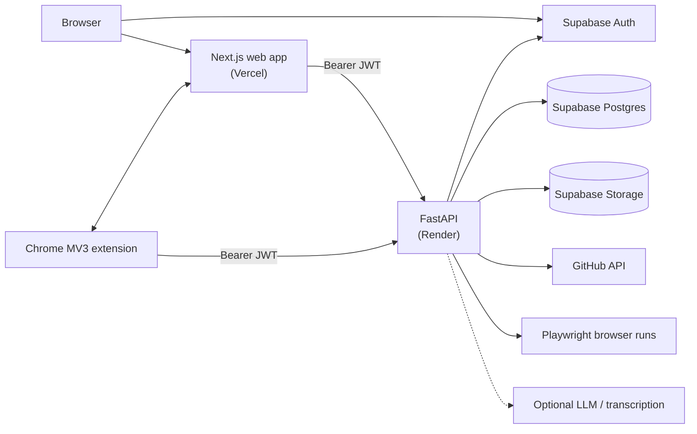

# VeriBridge AI

VeriBridge AI turns a student's project work into evidence a recruiter can inspect. A student
attaches proof to a project:

- a GitHub repository;
- a recorded walkthrough of the live website;
- documents;
- a recorded "Project Defense" Q&A.

The system analyses each proof and produces a **Verified Build Report**: qualitative evidence labels
per claimed skill, with an explicit statement of how the candidate relates to the project. The
student decides what to publish on a public **Work Passport**. Recruiters search published passports
and organise candidates in a recruiter workspace.

> **Service status (2026-11-10).**
> - The landing page at <https://veribridgeai.com> is live.
> - The [Chrome Web Store listing](https://chromewebstore.google.com/detail/veribridge-website-proof/gdogdgnaioldjldljniffcmkcdpdjlme)
>   for the recorder extension is live.
> - The hosted API (Render) is **suspended** and returns `503`. Sign-up, sign-in and every
>   data-backed page are unavailable on the hosted site until it is resumed.
> - Everything in this repository can still be run locally (see [Local setup](#local-setup)).

## Architecture



| Path | What it is |
|---|---|
| [`apps/web`](apps/web) | Next.js 16 (App Router, React 19, TypeScript, Tailwind) on Vercel: student, recruiter and public pages |
| [`apps/api`](apps/api) | FastAPI service on Render: evidence analysis, reports, passports, recruiter workspace |
| [`apps/api/app/db/migrations`](apps/api/app/db/migrations) | Postgres schema: 75 ordered SQL migration files (`001`–`073`, plus the conditional hardening migrations `074a` and `074b`). RLS is enabled on every table the migrations create, including the four proof/video tables added in migration 073; access is API-mediated with the service role. |
| [`apps/extension`](apps/extension) | Chrome Manifest V3 "Website Proof Recorder" |
| [`packages/shared`](packages/shared) | Recorder contract shared by the extension and the web app's tests |
| [`docs`](docs) | Specs, design notes, QA and Chrome Web Store material |

[`docs/ARCHITECTURE.md`](docs/ARCHITECTURE.md) has the full diagrams: system, evidence pipeline and
auth flow.

## Features

Status key:

- **IMPLEMENTED**: end-to-end code with tests.
- **PARTIAL**: works but depends on optional configuration, or is off by default.
- **PROTOTYPE**: UI backed by sample or local mock data.
- **PLANNED**: not built.
- **SUSPENDED-SERVICE**: implemented, but the hosted backend is currently off.

| Feature | Status | Where in the code |
|---|---|---|
| Landing page | IMPLEMENTED (live) | `apps/web/src/app/page.tsx`, `apps/web/components/landing-v2` |
| Sign-in: email OTP and Google OAuth via Supabase Auth | IMPLEMENTED / SUSPENDED-SERVICE (hosted) | `apps/web/src/app/login/page.tsx`, `apps/api/app/core/auth.py` |
| Projects and Verified Build Report | IMPLEMENTED / SUSPENDED-SERVICE | `apps/api/app/services/vbr_student_report.py`, `apps/web/src/app/student/vbr` |
| GitHub proof (repository analysis via the GitHub API) | IMPLEMENTED | `apps/api/app/api/v1/endpoints/github_proofs.py`, `apps/api/app/services/extension_proof_github_analysis_service.py` |
| Website proof: extension recording, live-site check, Playwright browser verification | IMPLEMENTED | `apps/extension`, `apps/api/app/services/website_browser_verification_executor_service.py` |
| Website semantic verification (sentence-transformers similarity plus expected-output matching) | IMPLEMENTED | `apps/api/app/services/website_semantic_similarity_service.py`, `apps/api/app/services/website_expected_output_match_service.py` |
| Document proof (PDF / DOCX) | IMPLEMENTED | `apps/api/app/api/v1/endpoints/document_proofs.py` |
| Project Defense (recorded Q&A about the project) | PARTIAL: transcription needs `TRANSCRIPTION_PROVIDER` (default `none`) | `apps/api/app/api/v1/endpoints/vbr_project_defense.py`, `apps/api/app/services/transcript_refinement_service.py` |
| Candidate attribution (project evidence kept separate from candidate ownership) | IMPLEMENTED | `apps/api/app/services/candidate_attribution_service.py`, migration `071` |
| Work Passport `/p/{slug}` with granular disclosure and privacy switch | IMPLEMENTED / SUSPENDED-SERVICE | `apps/api/app/services/vbr_work_passport_service.py`, `apps/api/app/services/passport_disclosure.py` |
| Public report links `/vbr/report/{token}` (publish / unpublish) | IMPLEMENTED / SUSPENDED-SERVICE | `apps/api/app/services/vbr_public_project_report.py` |
| Beam links and QR cards | IMPLEMENTED | `apps/api/app/services/beam_link_service.py` |
| Evidence-derived skill gaps | IMPLEMENTED | `apps/api/app/api/v1/endpoints/skill_gaps.py` |
| Recruiter workspace: search, connections, hiring briefs, interview workspace, talent pools, saved searches, comparisons | IMPLEMENTED / SUSPENDED-SERVICE | `apps/api/app/services/recruiter_*`, `apps/web/src/app/recruiters` |
| Admin quality review and role management | IMPLEMENTED | `apps/api/app/api/v1/endpoints/admin_quality_review.py`, `admin_user_roles.py` |
| LLM claim synthesis (Anthropic or a local OpenAI-compatible server) | PARTIAL: off by default; deterministic fallback | `apps/api/app/services/llm_proof_synthesis_service.py` |
| OCR / visual frame analysis | PARTIAL: optional providers, default `none` | `apps/api/app/services/workflow_visual_analysis_service.py` |
| Apple Wallet pass | PARTIAL: needs signing certificates, disabled by default | `apps/api/app/api/v1/endpoints/apple_wallet_pass.py`, [`docs/apple-wallet-pass-setup.md`](docs/apple-wallet-pass-setup.md) |
| Evidence-access request inbox (recruiter asks a student for more evidence) | PROTOTYPE: localStorage mock store | `apps/web/src/lib/mock-evidence-access-store.ts` |
| Student applications, jobs, mock interview, visa-fit dashboards | PROTOTYPE: sample data, labelled as such | `apps/web/src/app/dashboard/{applications,jobs,mock-interview,visa-fit}` |
| University dashboards | PROTOTYPE: sample data | `apps/web/src/app/university` |
| CI workflows, container images | PLANNED: `infra/` holds empty placeholders | none |

## Security model

- **Authentication.** Supabase Auth issues JWTs. The API verifies every token in
  `apps/api/app/core/auth.py`:
  - HS256 tokens only against the project JWT secret;
  - ES256/RS256 tokens only against the project JWKS;
  - anything else fails closed.
- **Authorization.**
  - The API talks to Postgres and Storage with the **service-role key**, which bypasses RLS. So
    ownership and role checks are enforced **in application code** (for example
    `get_owned_vbr_project_or_404`, `permission_service.py`), and the tests cover them.
  - **Row Level Security.** RLS is enabled on every table the migrations create, including the four proof/video tables added in migration 073; access is API-mediated with the service role. RLS is defence in depth against direct Supabase access with the
    anon or user key. It is not what protects API requests.
- **Public surfaces** (passport, report links, Beam links) need no session.
  - Report links use random tokens (`secrets.token_urlsafe(24)`). They stay valid until the owner
    unpublishes, and resolve only while the owner's passport is public.
  - Disclosure fails closed: if the owner's disclosure settings cannot be read, every public surface
    treats the passport as private (the report 404s and its `/view` tracker records nothing).
  - Responses are filtered so they never carry storage paths, signed URLs, emails or internal user/auth IDs.
  - Retained artifacts are streamed by the API. Proof-artifact signed URLs last at most 5 minutes;
    defense-recording playback URLs last 30 minutes.
- **Secrets.** Secrets live only in untracked `.env` files and in the hosting dashboards. The web
  app must never receive `SUPABASE_SERVICE_ROLE_KEY`. In production the API refuses its
  development demo-user fallback.
- **Deployment guards.** `ENVIRONMENT` is normalised and must be a known value, and a Render process
  must run as `production`. In production the API refuses to start if the demo fallback is enabled
  or `CORS_ALLOWED_ORIGINS` is empty or contains a wildcard, `null` or a local/private origin; it
  does not mount the docs or debug routes, and public report and access tokens are redacted from its logs. The web app
  sends baseline security headers (`nosniff`, `X-Frame-Options: DENY` with `frame-ancestors 'none'`,
  Referrer-Policy, Permissions-Policy, HSTS), not a full Content-Security-Policy.

These controls have not been independently audited.

## Tests

Results for the merged state as of 2026-11-10 (all security branches merged), on macOS. Python 3.11.14 with `apps/api/requirements.txt` installed.
Node 24.11.1 / npm 11.21.0.

| Suite | Command | Result |
|---|---|---|
| API (pytest) | `cd apps/api && pytest` | **5,151 passed, 14 skipped**, 0 failed |
| Web unit (Vitest) | `cd apps/web && npx vitest run` | **1,946 passed** (73 files) |
| Web types | `cd apps/web && npx tsc --noEmit` | clean |
| Web production build | `cd apps/web && npm run build` | succeeds |
| Extension (node test runner) | `cd apps/extension && npm test` | **76 passed** |
| Extension types | `cd apps/extension && npm run typecheck` | clean |
| Extension store build | `cd apps/extension && npm run build:release` | succeeds |

Notes:

- API tests use an in-memory store and make no Supabase calls. Some semantic-verification tests
  download the `all-MiniLM-L6-v2` model on first run. Tests for optional backends (Tesseract and
  other local OCR/vision providers) are skipped when those packages are not installed: the 14 skips
  are 11 OCR tests that need `pytesseract` and 3 opt-in smoke tests that need
  `VISUAL_REASONING_ENABLED=true`.
- Playwright suites exist in `apps/web/e2e` (mocked), `apps/web/e2e-local` (local stack) and
  `apps/web/e2e-prod` (the live site; it needs QA sessions and `VB_PROD_REPORT_TOKEN_*`). None of
  them were part of the results above, and the production suites cannot run while the API is suspended.
- No CI is configured. Run the suites locally.

## Local setup

Prerequisites: Python 3.11+, Node.js 20+ and npm, and a Supabase project (the free tier is enough).
Only placeholder names are shown here. Copy each `.env.example` and fill in your own values. Never
commit `.env` files.

### 1. Database (Supabase)

1. Create a Supabase project.
2. Apply the 75 migration files in `apps/api/app/db/migrations/` in order in the SQL editor:
   `001_*.sql` to `073_*.sql`, then `074a_*.sql` and `074b_*.sql`. In production, `074a` and `074b`
   are conditional hardening: apply them only after a check on a staging project (see each file's
   header).
   - `033` and `046` alter `project_defense_analysis_results`, which no migration creates (the
     production table predates the migrations). A bootstrap migration is pending (see
     `075_bootstrap_note_project_defense_analysis_results.md`), so a fresh database currently needs
     that table created before `033` is applied.
   - On a fresh database the migrations leave owner-scoped write policies for signed-in users on 62
     tables, so a user can write their own rows directly through PostgREST, not only through the
     API. For example, the `extension_proof_uploads` UPDATE policy from `013`, which `061` leaves in
     place, has a `WITH CHECK` on `user_id` only, so a user can re-point their own upload at another
     session. Whether production has these policies is checked by the production verification query.
3. Create the private Storage buckets named by `SUPABASE_VBR_MEDIA_BUCKET` and
   `SUPABASE_PROOF_ARTIFACT_BUCKET` (`.env.example` values `vbr-media` and `proof-artifacts`).
   - Project Defense media and keyframe evidence use further private buckets named by
     `SUPABASE_DEFENSE_MEDIA_BUCKET` and `SUPABASE_FRAME_EVIDENCE_BUCKET`. These are not in
     `.env.example` and have no default.
   - Migration 054 creates the `passport-avatars` bucket, which is public by design (passport
     photos). Set `SUPABASE_PASSPORT_AVATAR_BUCKET` to that name.
4. Enable email OTP, and optionally Google, under Supabase Auth.

### 2. API (`apps/api`)

```bash
cd apps/api
python3.11 -m venv .venv && source .venv/bin/activate
pip install -r requirements.txt
python -m playwright install chromium   # needed for website browser verification
cp .env.example .env                    # then fill in values
uvicorn app.main:app --reload --port 8000
curl http://localhost:8000/api/v1/health
```

Key variables in `apps/api/.env.example`:

- `SUPABASE_URL`, `SUPABASE_ANON_KEY`, `SUPABASE_SERVICE_ROLE_KEY`, `SUPABASE_JWT_SECRET`
- `CORS_ALLOWED_ORIGINS`, `FRONTEND_URL`, `ENVIRONMENT`
- optional: `GITHUB_TOKEN` (higher GitHub rate limits), `TRANSCRIPTION_PROVIDER`,
  `VISUAL_ANALYSIS_PROVIDER`, `LLM_SYNTHESIS_ENABLED` / `LLM_SYNTHESIS_PROVIDER`, and the
  `APPLE_WALLET_*` settings

### 3. Web app (`apps/web`)

```bash
cd apps/web
npm ci
cp .env.example .env.local              # then fill in values
npm run dev                             # http://localhost:3000
```

Variables in `apps/web/.env.example`:

- `NEXT_PUBLIC_API_URL` / `NEXT_PUBLIC_API_BASE_URL` (e.g. `http://localhost:8000`)
- `NEXT_PUBLIC_APP_URL`, `NEXT_PUBLIC_SUPABASE_URL`, `NEXT_PUBLIC_SUPABASE_ANON_KEY`
- optional: `NEXT_PUBLIC_RECORDER_EXTENSION_STORE_URL`, `NEXT_PUBLIC_OTP_CODE_LENGTH`

### 4. Extension (`apps/extension`)

```bash
cd apps/extension
npm ci
npm run build      # dev channel: trusts localhost app and API origins
```

In Chrome, open `chrome://extensions`, enable Developer mode, choose **Load unpacked** and select
`apps/extension`. `npm run build:release` / `npm run package:release` produce the store build.
See [`apps/extension/README.md`](apps/extension/README.md) for details.

## Known limitations

- **The hosted API is suspended.** Hosted sign-in and every data-backed page are unavailable until it resumes.
- **No CI, and no migration runner.** Migrations are applied by hand, in order.
- **Public report links have no expiry.** Tokens are stored as plain values in
  `vbr_projects.public_report_token`; revocation means unpublishing.
- **Known issue in website semantic verification.** If the sentence-transformers model is
  unavailable, expected-output matching falls back to exact signal matching. That fallback can count
  a negated mention ("no … appeared") as a match. The behaviour is unchanged on this branch and
  tracked as a separate fix.
- **The default install is heavy.** It pulls in `sentence-transformers` (and therefore PyTorch).
  Optional OCR, vision, Whisper and LLM backends are documented in `apps/api/requirements.txt` but
  not installed by default.
- **Some sections are prototypes on sample data.** See the features table (university, applications,
  jobs, visa-fit, mock interview, evidence-access inbox).
- **Some older documents describe the early scaffold.**
  - `apps/api/README.md`, `docs/architecture/*_plan.md` and the root `.env.example` predate the
    current system. The root `.env.example` lists variables the apps no longer read; use the
    per-app `.env.example` files.
  - The API's default `APP_NAME` is still the early project name.

## Licence

The repository has no `LICENSE` file, so no licence is granted and default copyright applies.

## Development notes

This is a solo project, built with AI coding assistants (Claude) under the author's direction. The
author owned the architecture, review, integration, testing and deployment.

Repository evidence:

- as of `ecfc84a` (2026-08-24), all 649 commits on `main` (from 2026-05-07) are authored by the owner's account;
- all 95 pull requests were opened by the owner (93 merged);
- 217 commit messages carry Claude `Co-Authored-By` trailers.

See [`CONTRIBUTING.md`](CONTRIBUTING.md) for commit conventions.
