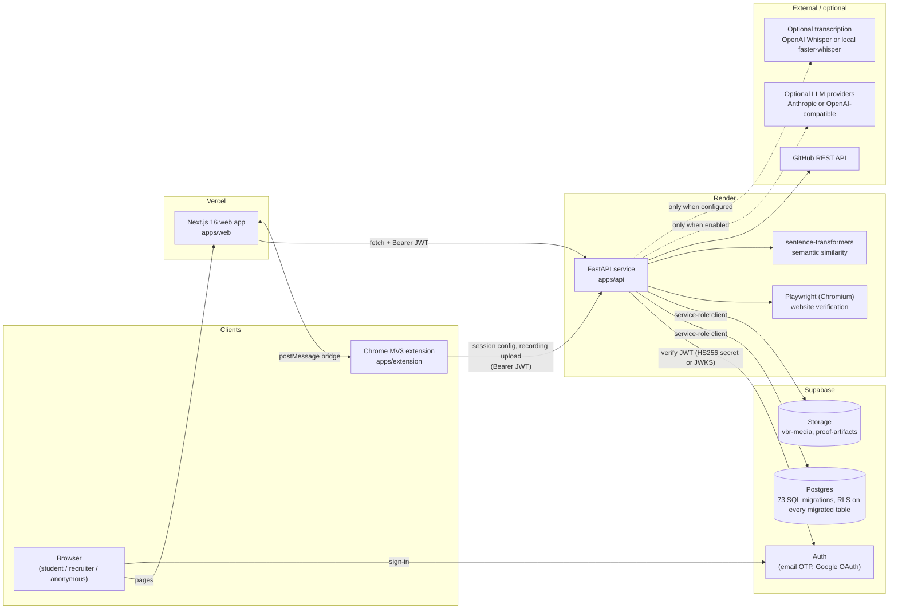
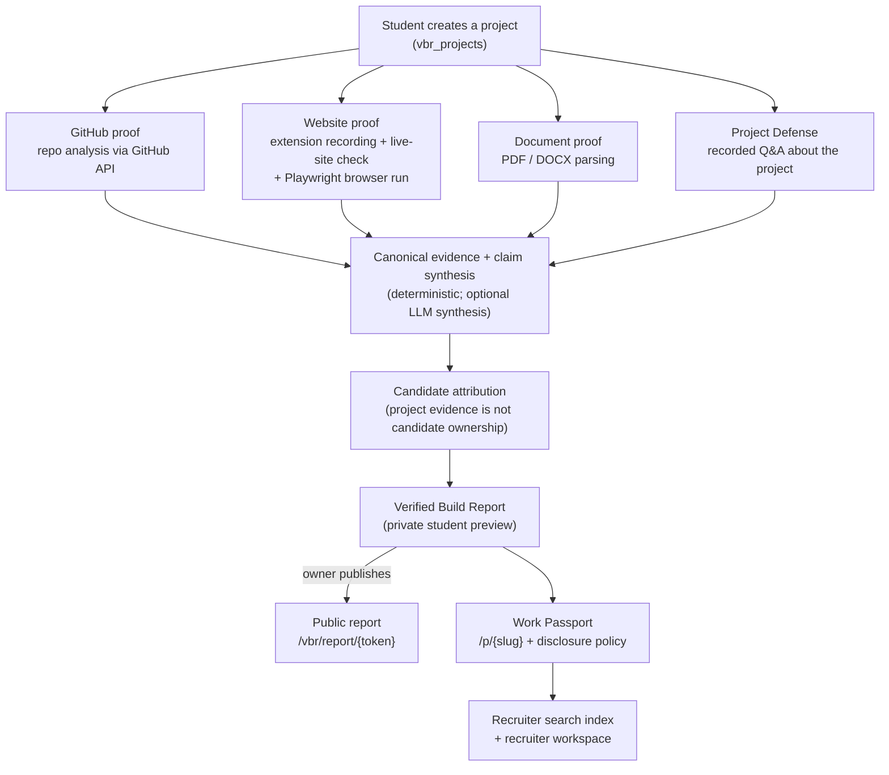
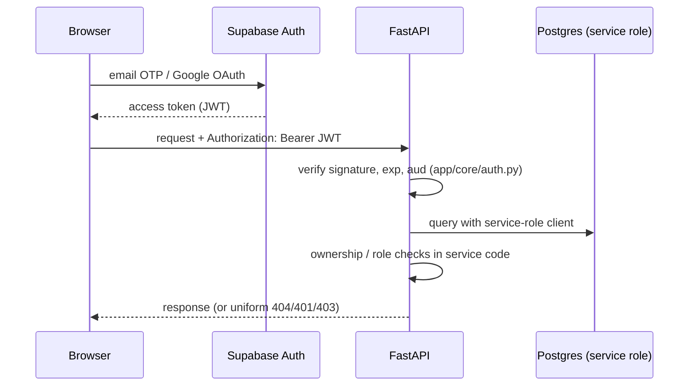

# VeriBridge AI architecture

This document describes the system as it exists in this repository. For features, status and setup,
see the [README](../README.md).

## System overview

- **Web (`apps/web`).** Next.js App Router, React 19, TypeScript, Tailwind. Every data call goes to
  the API through `src/lib/api.ts`, which attaches the Supabase access token. The browser uses the
  Supabase client only for authentication (`src/lib/supabase/`).
  `src/proxy.ts` redirects unauthenticated users away from `/student/**`, `/dashboard/**` and
  `/onboarding`. That redirect is a UX gate; the security boundary is the API.
- **API (`apps/api`).** FastAPI app with 72 router registrations under `/api/v1`
  (`app/api/v1/router.py`). Business logic lives in `app/services/`. Unit tests run against an
  in-memory dict store, so they never touch Supabase.
- **Extension (`apps/extension`).** Chrome Manifest V3, the "VeriBridge Website Proof Recorder".
  It records a student-started website demonstration (screen capture plus on-page evidence) and
  uploads it to the API for the session the web app configured. The extension and the web app talk
  through a content-script `window.postMessage` bridge. The recorder contract lives in
  `packages/shared/websiteProofRecorderContract.ts`; the extension imports it, and web tests check
  against it.
- **Supabase.**
  - Auth issues the JWTs.
  - Postgres holds all application data. The schema is `apps/api/app/db/migrations/` (`001` to `073`),
    applied in order. A fresh database currently needs the workarounds listed under
    [Local setup](../README.md#1-database-supabase) in the README.
  - Storage holds recorded media and retained proof artifacts. Buckets are private; the API streams
    the bytes. Proof-artifact signed URLs last at most 5 minutes; defense-recording playback URLs last 30 minutes.

## Evidence pipeline

The design rules below are enforced in code:

- **Qualitative evidence labels, not numeric trust scores, on public surfaces.** See
  `vbr_public_project_report.py` and `public_report_safety_service.py`.
- **Project evidence is never presented as proof of personal authorship.** Attribution has its own
  states (`unknown`, `claimed_contributor`, `verified_contributor`, `denied_by_candidate`, `conflicted`, `verified_author`).
  See `candidate_attribution_service.py` and migration 071.
- **The deterministic path works with no model access.** LLM synthesis is off by default
  (`LLM_SYNTHESIS_ENABLED=false`, `LLM_SYNTHESIS_PROVIDER=disabled`). Transcription and
  visual/OCR analysis default to `none` and degrade to "not configured".

## Authentication and authorization

- **JWT verification** (`app/core/auth.py`).
  - HS256 tokens are checked only against `SUPABASE_JWT_SECRET`.
  - ES256/RS256 tokens are checked only against the project's JWKS.
  - The header `alg` picks the key material, which prevents algorithm-confusion attacks.
  - Anything unverifiable fails closed.
- **Authorization is enforced in the application layer.** `get_db` returns a service-role client,
  which bypasses RLS, so every owner-scoped operation checks ownership explicitly (for example
  `get_owned_vbr_project_or_404`). Roles (student, recruiter, admin, reviewer) are resolved by
  `permission_service.py`.
- **RLS is defence in depth.** RLS is enabled on every table the migrations create, including the four proof/video tables
  added in migration 073; access is API-mediated with the service role. RLS limits what an anon or
  authenticated Supabase key could reach directly. It does **not** constrain the API itself,
  because the API uses the service-role key.
- **Public surfaces need no session.** These are the public passport `/p/{slug}`, report links
  `/vbr/report/{token}`, and Beam/QR links.
  - Report tokens come from `secrets.token_urlsafe(24)` and are stored in
    `vbr_projects.public_report_token`. They have no expiry; unpublishing clears the token.
  - A report resolves only while the owner's Work Passport is public and the disclosure policy
    allows it.
  - Unknown, revoked and hidden reports all return the same 404.
- **Demo user fallback.** It works only outside `ENVIRONMENT=production` and only when
  `ENABLE_DEMO_USER_FALLBACK=true`.

## Deployment

| Component | Host | Notes |
|---|---|---|
| Web app and landing page | Vercel | `https://veribridgeai.com` |
| API | Render (`veribridge-api.onrender.com`) | **Currently suspended.** The service answers `503 Service Suspended`. |
| Database, Auth, Storage | Supabase | Migrations are applied manually (SQL editor or the `scripts/apply_*.py` helpers). |
| Extension | Chrome Web Store | Release build via `npm run build:release` / `npm run package:release` |

Infrastructure is configured in each provider's dashboard. The repository has no deployment
manifests (no `render.yaml`, `vercel.json` or Dockerfile) and no CI workflow. `infra/docker` and
`infra/github-actions` are empty placeholders.
